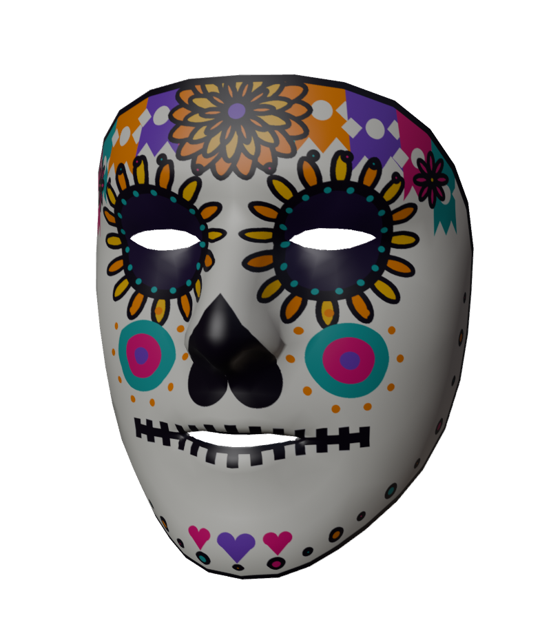
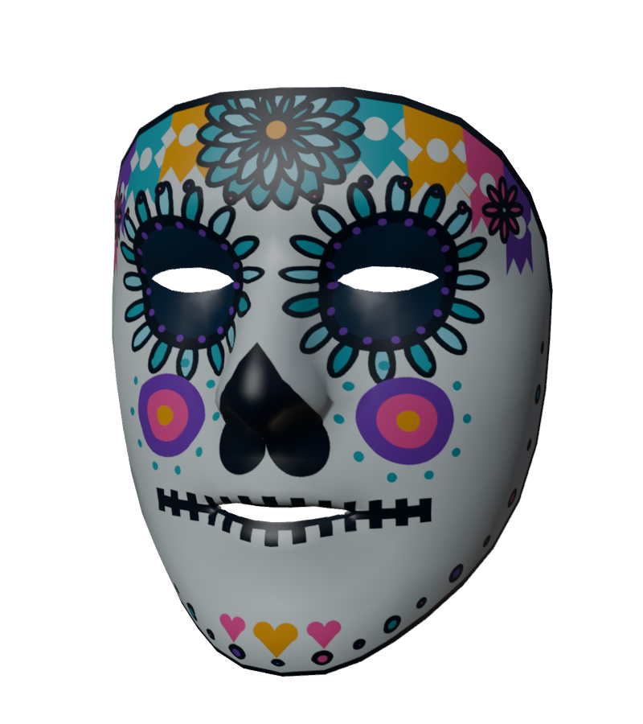
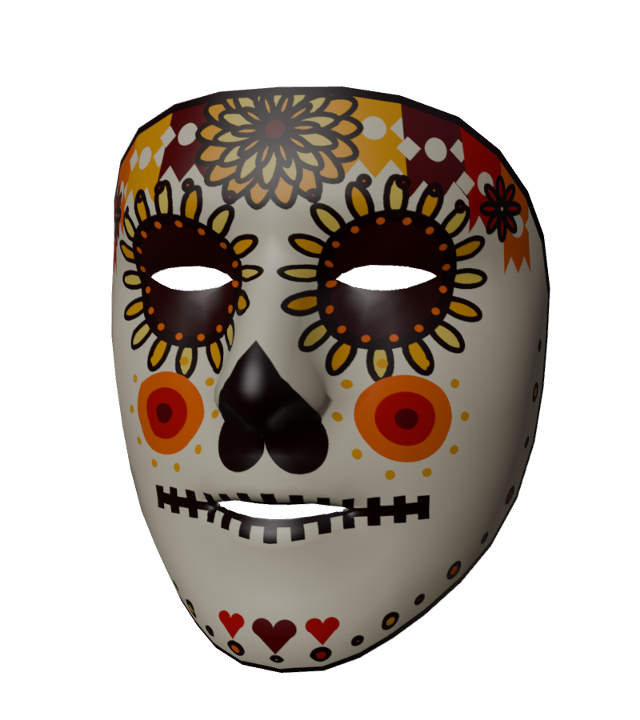

# Calavera Blox 💀🌼 · máscara de Día de Muertos

Filtro de **Realidad Aumentada** que pinta una **calavera de azúcar** de diseño propio sobre la **malla facial** del usuario. La textura se pintó sobre el mapa UV de la malla de MediaPipe, así que los adornos caen justo en ojos, nariz, boca y contorno, y **se deforman con los gestos** sin desprenderse.

> Actividad 3 · Realidad Virtual y Aumentada: Máscara de Día de Muertos con mapeo facial de precisión (mejora de la Actividad 2).

**▶ Probar:** https://rosaurarosauraaa.github.io/calavera-blox/
**🎥 Video demo:** _(agregar enlace al video de 30–60 s)_

| Clásica | Turquesa | Dorada |
|---|---|---|
|  |  |  |

## Diseño

Elementos tradicionales del Día de Muertos, con colores saturados y contornos gruesos para que se lean bien en cámara:

- **Cempasúchil:** una flor grande de tres coronas en la frente y una corona de pétalos alrededor de cada ojo.
- **Papel picado:** banderitas de colores con recortes y borde en zigzag en la parte alta de la frente.
- **Calavera:** cuencas oscuras, nariz de corazón invertido y boca cosida.
- **Detalles:** círculos en las mejillas, puntos sobre las cejas, festón de puntos en la mandíbula y corazones en la barbilla.
- **Ojos y boca interior transparentes:** se ven los ojos reales y al abrir la boca se ve la boca real.
- Diseño simétrico: cada adorno se coloca con pares de landmarks izquierda/derecha.

## Mejora frente a la Actividad 2

| | Actividad 2 (Cabeza Cubo) | Actividad 3 (Calavera Blox) |
|---|---|---|
| Geometría | Modelo rígido encima de la cara | **La malla facial real** (468 vértices) actualizada en cada frame |
| Ajuste | Posición, escala y rotación globales | **Cada vértice** sigue su landmark: ojos, nariz, boca y contorno alineados |
| Gestos | Shape keys que imitan el gesto | La textura **se deforma igual que la cara** (sonrisa, boca abierta, cejas) |
| Textura | Materiales de color | Textura de 1024 px pintada sobre el **mapa UV**, sin costuras y con transparencias |

## Proceso de ajuste preciso

1. **Malla con UV:** se usó el modelo canónico de MediaPipe (`assets/mesh/canonical_face_model.obj`). Su orden de vértices es el mismo que el de los landmarks.
2. **Plantilla UV:** Blender → UV Editor → *Export UV Layout* ([`docs/uv-plantilla.svg`](docs/uv-plantilla.svg)), con el script [`blender/uv_y_preview.py`](blender/uv_y_preview.py).
3. **UV por vértice:** el OBJ usa índices distintos para vértices y UV. [`tools/build_mesh.py`](tools/build_mesh.py) los reordena a una UV por landmark y genera `assets/mesh/face_mesh.json`.
4. **Pintar sobre la plantilla:** [`tools/paint_texture.py`](tools/paint_texture.py) dibuja cada adorno en la posición UV de landmarks reales (contorno de ojos, labios, nariz, frente, mejillas). Pinta con supermuestreo 2× para tener bordes suaves y deja transparentes los ojos y la boca.
5. **Revisión en Blender:** la textura se aplicó a la malla y se renderizó (imágenes de arriba).
6. **En vivo:** [`js/main.js`](js/main.js) mueve los 468 vértices a los landmarks de cada frame; las UV y los triángulos no cambian.

## Interactividad

| Gesto | Efecto temático |
|---|---|
| 😮 **Abrir la boca** (> 45 %) | **Lluvia de pétalos de cempasúchil** desde arriba de la cabeza y un soplo de pétalos desde la boca, con arpegio de marimba. |
| 🤨 **Subir las cejas** (> 55 %) | **Cambio de color** de la calavera (clásica → turquesa → dorada) con destello, y aparece un **arco de velas** encendidas alrededor de la cabeza. |
| Siempre | Caen algunos pétalos alrededor como ambientación. |

## Herramientas

- **Blender 5.2**: exportar la plantilla UV y revisar la textura sobre la malla.
- **Python + Pillow**: pintar la textura sobre la plantilla UV.
- **MediaPipe Tasks Vision 0.10.14** (Face Landmarker): malla facial de 478 puntos y blendshapes.
- **three.js r160**: malla dinámica con textura, pétalos y velas (sprites).
- **Web Audio API**: sonidos sintetizados.

## Estructura

```
index.html
css/style.css
js/main.js                       cámara, malla facial, gestos, pétalos y velas
js/sfx.js                        sonidos
assets/mesh/canonical_face_model.obj   malla canónica de MediaPipe (Apache 2.0)
assets/mesh/face_mesh.json       UV por landmark + triángulos
assets/textures/calavera-*.png   texturas (3 paletas)
tools/build_mesh.py              OBJ -> JSON
tools/paint_texture.py           pinta las texturas sobre la plantilla UV
blender/uv_y_preview.py          plantilla UV y renders
docs/                            plantilla, renders y artículo
```

## Instalación y ejecución

1. **En el teléfono:** abre https://rosaurarosauraaa.github.io/calavera-blox/ y permite la cámara. Toca la pantalla una vez para activar el sonido.
2. **En la compu:** `npx serve .` y abre `http://localhost:3000`.
3. **Regenerar recursos:**
   ```bash
   python tools/build_mesh.py
   pip install pillow && python tools/paint_texture.py
   blender -b -P blender/uv_y_preview.py
   ```

### Publicar en GitHub Pages
Settings → Pages → *Deploy from a branch* → `main` / `(root)`.

## Pruebas

- [ ] Teléfono 1: _(modelo / navegador)_
- [ ] Teléfono 2: _(modelo / navegador)_
- [ ] Varios rostros · con lentes · distinta iluminación

## Créditos y licencias

| Recurso | Autor | Licencia |
|---|---|---|
| Diseño y texturas de la calavera | Rosaura Quintana | CC BY 4.0 |
| Efectos de sonido | Rosaura Quintana (Web Audio) | CC BY 4.0 |
| `canonical_face_model.obj` (malla y UV) | [Google MediaPipe](https://github.com/google-ai-edge/mediapipe/tree/master/mediapipe/modules/face_geometry/data) | Apache 2.0 |
| [MediaPipe Tasks Vision](https://developers.google.com/mediapipe) + modelo Face Landmarker | Google | Apache 2.0 |
| [three.js](https://threejs.org) | three.js authors | MIT |

Código bajo licencia [MIT](LICENSE).
